<p><picture><source media="(max-width: 600px)" srcset="assets/readme/hero-mobile.svg"/>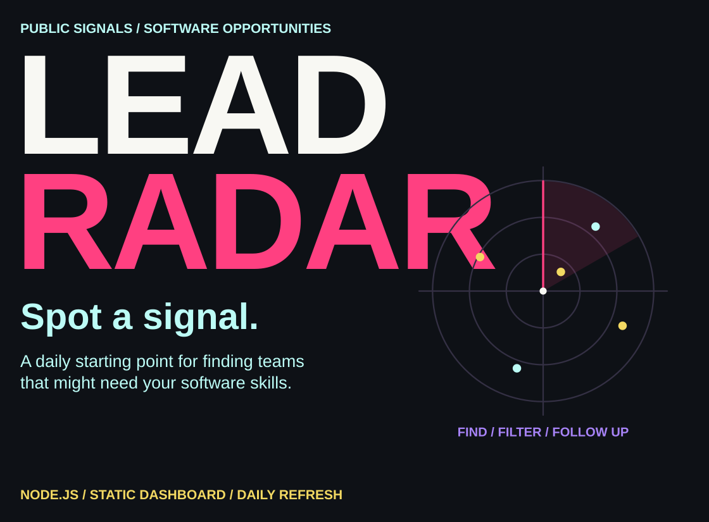</picture></p>

<p align="center"><a href="#what-i-built">Overview</a> · <a href="#where-signals-come-from">Sources</a> · <a href="#run-locally">Run locally</a> · <a href="#daily-refresh-and-pages">Deploy</a> · <a href="#the-dashboard">Dashboard</a> · <a href="#explore-and-customize">Customize</a></p>

I built Lead Radar to turn scattered launch posts and business updates into a shortlist for software freelancers and agencies. It collects public-source items, applies transparent scoring rules and presents the results in a static dashboard with research links, editable outreach templates and a browser-local tracker.

##  What I built

<p><picture><source media="(max-width: 600px)" srcset="assets/readme/features-mobile.svg"/>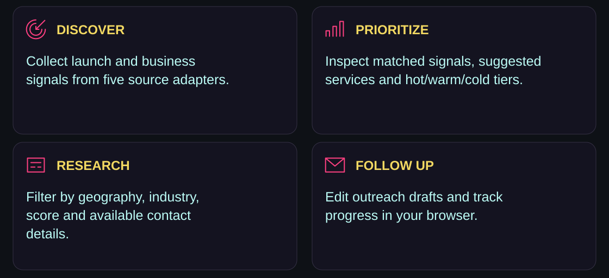</picture></p>

The default scraper uses Node’s built-in APIs with no package dependencies and requires no paid-enricher keys. Optional provider integrations can add contact and company details. Availability, source rate limits and provider plans still affect individual runs.

##  Where signals come from

<p><picture><source media="(max-width: 600px)" srcset="assets/readme/sources-mobile.svg"/>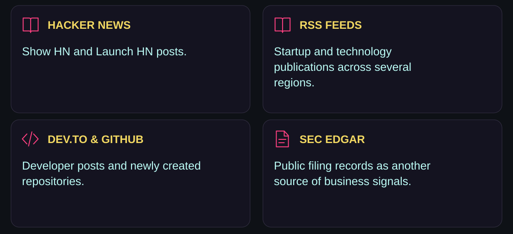</picture></p>

The RSS adapter includes publications such as EU-Startups, Tech.eu, TechCrunch, Sifted, Disrupt Africa, LatamList and Tech in Asia. Source responses may be empty, rate-limited or blocked; `leads.json` includes source statistics and recorded errors for inspection.

##  From public posts to a shortlist

<p><picture><source media="(max-width: 600px)" srcset="assets/readme/pipeline-mobile.svg"/>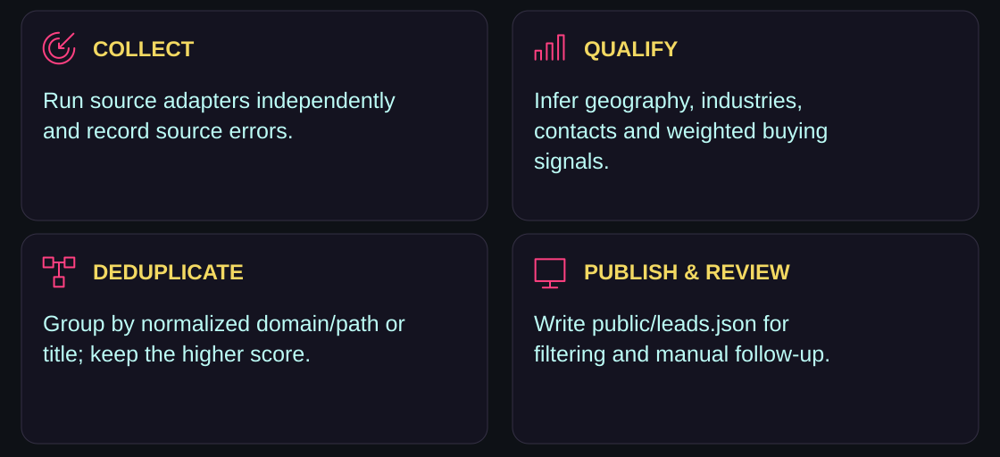</picture></p>

<details>
<summary><strong>How the rules prioritize leads</strong></summary>

The score adds weighted positive signals, subtracts non-fit signals and clamps the total to `0–100`. Positive title matches receive a `1.5×` multiplier.

| Positive signals | Non-fit signals |
|---|---|
| Launches, MVPs, funding and waitlists | Large or established organizations |
| Manual workflows and requests for an app | Tutorials, opinions and listing posts |
| Hiring, scaling and small teams | Investor funds, editorial content and personal narratives |

Tiers are **hot ≥ 50**, **warm ≥ 25** and **cold < 25**. Matching signals also suggest up to four services. These are hand-written rules, not a trained model or a calibrated conversion probability. Short descriptions can receive low scores even when the business is worth researching.

Deduplication uses normalized company domains, platform-specific paths or a normalized title. When records collide, the implementation keeps the higher-scoring record and records additional sources.

</details>

##  Run locally

<p><picture><source media="(max-width: 600px)" srcset="assets/readme/environment-mobile.svg"/>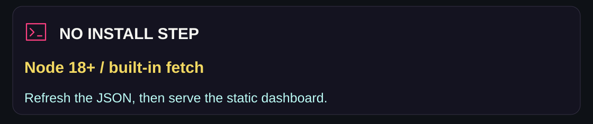</picture></p>

Requires **Node 18 or later**. No `npm install` step is needed for the current repository.

```bash
git clone https://github.com/adilsukumar/Lead-Radar.git
cd Lead-Radar

# Fetch, qualify and write public/leads.json
npm run update

# Serve the dashboard
npm run serve
```

Open `http://localhost:8080`. The refresh uses the network; serving the existing JSON does not fetch new leads. `npm start` is an alias for the update script. The local server also accepts a `PORT` environment variable.

##  Daily refresh and Pages

The existing [Daily lead refresh workflow](.github/workflows/daily.yml) is scheduled for **06:12 UTC daily** and supports manual runs. It uses Node 20, refreshes `public/leads.json`, commits the generated data when changed, and publishes the `public/` folder through GitHub Pages.

1. Open **Settings → Pages** in the repository.
2. Set **Build and deployment → Source** to **GitHub Actions**.
3. Open **Actions → Daily lead refresh → Run workflow**.

If refresh succeeds and deployment fails, check the Pages configuration and the deploy-job log. Scheduled runs depend on GitHub Actions availability and repository settings; the schedule is configuration, not a guarantee of an exact daily delivery time.

##  The dashboard

<p><picture><source media="(max-width: 600px)" srcset="assets/readme/dashboard-mobile.svg"/>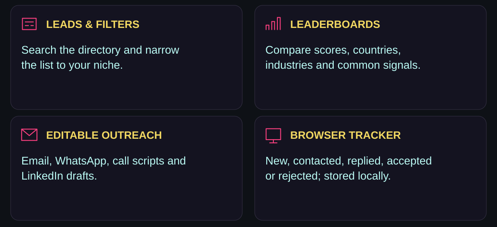</picture></p>

Search by keyword and filter by region, country, industry, minimum score and contact availability. Results are ordered by score, then recency.

Open a lead to inspect its business summary, matched signals, suggested services, pitch angle and available contact fields. Research links open Google, Maps, LinkedIn, Crunchbase and email lookups. They are lookup shortcuts, not verified profiles.

The detail panel provides editable **Email, WhatsApp, Call and LinkedIn** templates. Personalize your name, company and offer, then copy a draft or open the relevant app. The dashboard does not automatically send a campaign. Status changes feed the local pipeline and acceptance-rate display; these are your recorded outcomes, not a model forecast.

##  Optional provider enrichment

[.env.example](.env.example) lists the supported variables. The scraper reads `process.env`; it does **not** automatically load a local `.env` file. Export variables in your shell, or use your runtime’s environment-file support.

```powershell
# Optional: set in PowerShell before npm run update
$env:HUNTER_API_KEY = "your_key"
$env:ENRICH_TOP_N = "25"
npm run update
```

| Variable | Integration |
|---|---|
| `HUNTER_API_KEY` | Domain-based email lookup |
| `APOLLO_API_KEY` | Company phone, size, industry and location |
| `CRUNCHBASE_API_KEY` | Organization lookup and description |
| `ENRICH_TOP_N` | Maximum top-ranked leads sent to configured enrichers; default `25` |
| `GITHUB_TOKEN` | Optional authenticated GitHub source requests |

Provider access and returned fields depend on your account and the response. The existing Actions workflow injects `GITHUB_TOKEN` only; enabling paid enrichers in Actions requires explicitly wiring their secrets into that workflow. Adding a repository secret alone does not expose it to the scraper.

##  Coverage and storage

<p><picture><source media="(max-width: 600px)" srcset="assets/readme/scope-mobile.svg"/>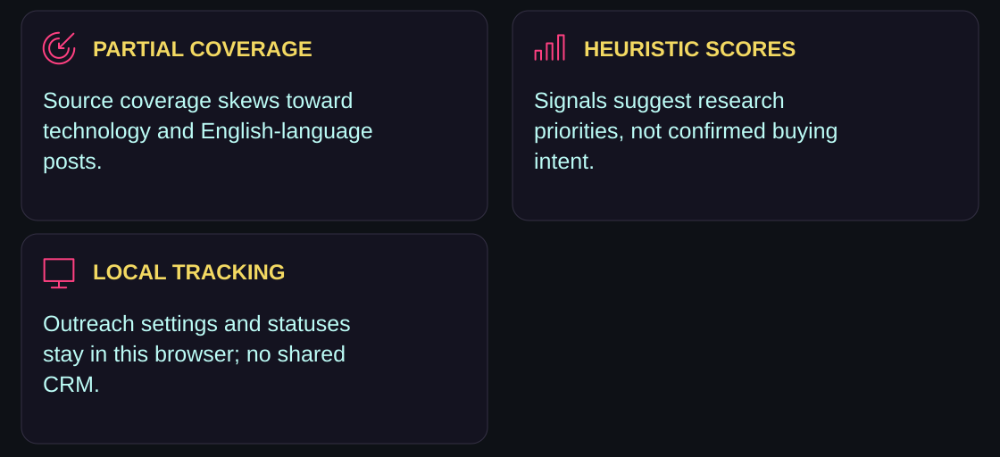</picture></p>

Public feeds do not cover every business or country. Geographic inference can be sparse, and contact information may be absent or outdated. Review the original source and the business before reaching out. Blocked feeds are recorded and skipped.

The static dashboard reads the generated JSON. Template identity settings and outreach statuses use browser `localStorage`; they are not synced between browsers or devices. Optional enrichment becomes part of the generated JSON, so review what will be published before deploying it publicly.

##  Explore and customize

<p align="center"><a href="src/sources/">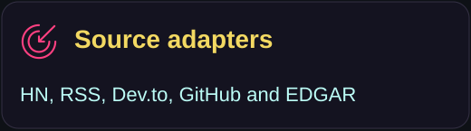</a> <a href="src/lib/score.js">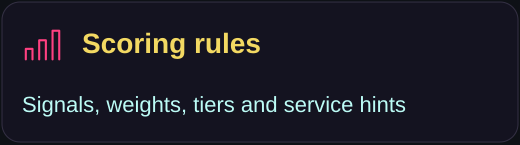</a> <a href="public/index.html">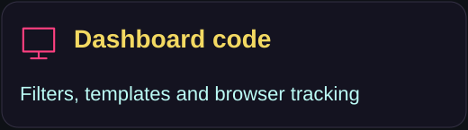</a> <a href=".github/workflows/daily.yml">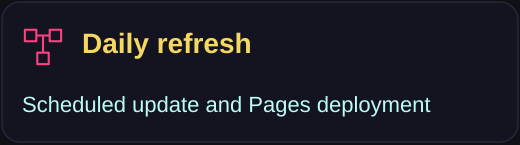</a></p>

| Change | Source |
|---|---|
| Source adapters and orchestration | [src/sources/](src/sources/) · [src/index.js](src/index.js) |
| Buying signals, weights and tiers | [score.js](src/lib/score.js) |
| Business summaries and pitch angles | [bizintel.js](src/lib/bizintel.js) |
| Industry rules | [classify.js](src/lib/classify.js) |
| Country and city inference | [geo.js](src/lib/geo.js) |
| RSS publications | [rssfeeds.js](src/sources/rssfeeds.js) |
| Paid provider adapters | [enrichers.js](src/lib/enrichers.js) |
| UI, templates and tracker | [public/index.html](public/index.html) |

### Network diagnostics

```bash
node scripts/smoke.mjs
node scripts/smoke-enrich.mjs
```

These existing scripts request live sources and print source counts, errors and enriched samples. They are diagnostics rather than an automated accuracy test suite.

### Repository map

```text
src/index.js             source orchestration and JSON output
src/serve.js             local static server
src/sources/             public-source adapters
src/lib/                 parsing, scoring, inference and enrichment
public/index.html        dashboard and browser-local tracker
public/leads.json        generated directory
.github/workflows/       scheduled refresh and Pages deployment
scripts/                 live source diagnostics
vercel.json              optional static deployment configuration
```

The package metadata declares the project **MIT**. The current tree has no standalone license file.

<p><picture><source media="(max-width: 600px)" srcset="assets/readme/closing-mobile.svg"/>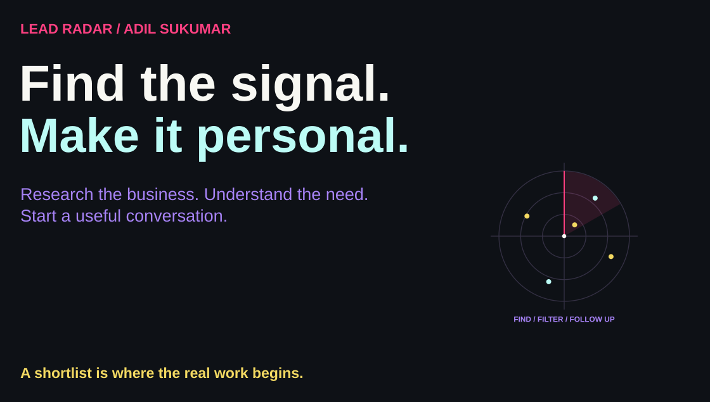</picture></p>

<p align="center"><a href="https://github.com/adilsukumar/Lead-Radar/issues">Discuss an improvement</a> · <a href="src/sources/">Add a source</a> · <a href="https://www.adilsukumar.xyz/">Meet the builder</a></p>
